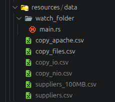
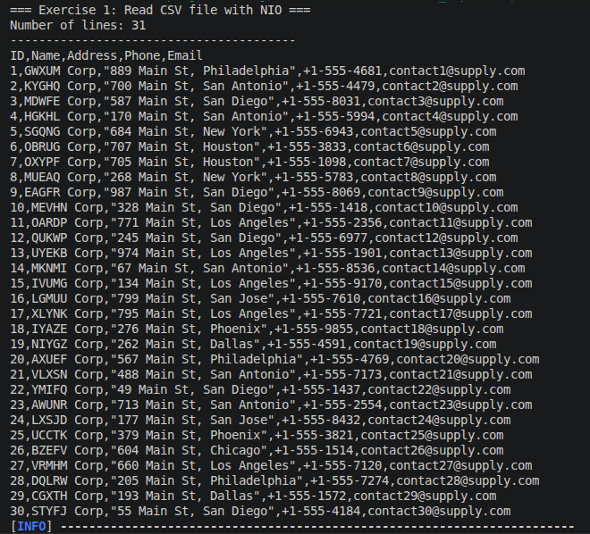
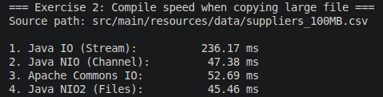
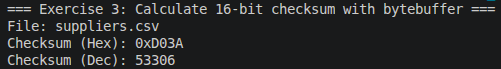
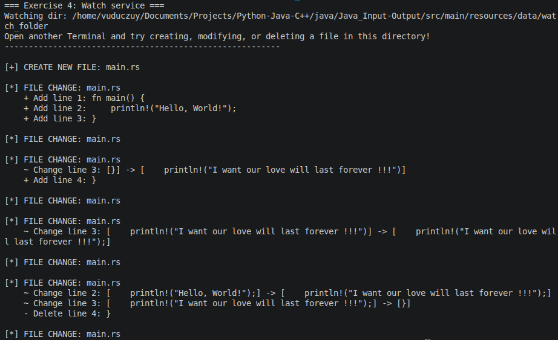

# Java Input - Output

**Дисциплина:** Проектирование и разработка клиент-серверных приложений  
**Учебный год:** 2026/2027  
**Технологии:** Java 25 LTS · Maven · JUnit 5 · Java Concurrency API

Практическая работа состоит из четырёх связанных заданий, посвящённых механизмам неблокирующего ввода-вывода в Java NIO: буферы (ByteBuffer), каналы (FileChannel), утилиты для работы с файлами (Path, Files), вычисление контрольных сумм (Checksum) и отслеживание изменений в файловой системе (WatchService).

## Содержание

1. [Задание 1. Чтение файла через java.nio](#задание-1-чтение-файла-через-javanio)
2. [Задание 2. Сравнение методов копирования файлов](#задание-2-сравнение-методов-копирования-файлов)
3. [Задание 3. Вычисление 16-битной контрольной суммы](#задание-3-вычисление-16-битной-контрольной-суммы)
4. [Задание 4. Мониторинг каталога через WatchService](#задание-4-мониторинг-каталога-через-watchservice)

Проверка версий:

```bash
java --version    # должно показывать Java 25
mvn --version     # Java version: 25
```

### Исходный код

- [task1/](src/main/java/nio/Task1ReadFile.java/) - Параллельная обработка массива
- [task2/](src/main/java/nio/Task2CopyFile.java) - Platform Threads и Virtual Threads
- [task3/](src/main/java/nio/Task3Checksum.java) - Асинхронная обработка запроса
- [task4/](src/main/java/nio/Task4WatchService.java) - Producer / Consumer

### Слишком тяжелые ресурсы



## Команды запуска

Сборка проекта:

```bash
mvn clean compile
```

Запуск тестов:

```bash
mvn test
```

Запуск отдельного задания:

```bash
# Задание 1 - параллельная обработка массива
mvn exec:java -Dexec.mainClass="nio.Task1ReadFile"

# Альтернативный способ (после mvn compile)
java -cp target/classes nio.Task1ReadFile
```

## Задание 1. Чтение файла через java.nio
[Содержание](#содержание)

### Цель

Освоить базовые механизмы чтения данных с помощью пакета `java.nio` и продемонстрировать использование буферов (`ByteBuffer`) и каналов (`FileChannel`) для неблокирующего ввода-вывода при работе с текстовыми файлами.

### Реализации

Для выполнения задания был создан текстовый файл suppliers.csv в формате CSV, содержащий данные о поставщиках (ID, Name, Address, Phone, Email), что соответствует предметной области «База данных АС Поставщиков». Чтение файла реализовано с использованием библиотеки Java NIO (NIO2). В классе Task1ReadFile путь к файлу формируется с помощью класса Paths, после чего применяется статический метод Files.readAllLines(), который считывает всё содержимое файла в коллекцию List<String> с явным указанием кодировки StandardCharsets.UTF_8. Данный подход позволяет избежать ручного управления буферами и обеспечивает эффективное неблокирующее чтение. Полученный список построчно выводится в стандартный поток вывода (System.out), а обработка возможных ошибок ввода-вывода осуществляется через блок try-catch с перехватом IOException.

### Результаты



### Вывод

В ходе выполнения первого задания были освоены базовые механизмы неблокирующего ввода-вывода библиотеки Java NIO. Использование современных классов Path и Files позволило реализовать чтение файла формата CSV максимально компактно и безопасно, избежав необходимости ручного управления потоками и буферами. Продемонстрирована возможность эффективной интеграции внешних данных (сгенерированных в соответствии с предметной областью «АС Поставщиков») в Java-приложение. Полученные навыки работы с файловой системой являются фундаментом для выполнения последующих, более сложных задач, связанных с копированием данных, вычислением контрольных сумм и мониторингом изменений в каталогах.

## Задание 2. Сравнение методов копирования файлов
[Содержание](#содержание)

### Цель

Провести сравнительный анализ производительности различных подходов к копированию файлов в Java. Необходимо реализовать копирование файла размером 100 МБ с использованием четырёх методов: классического потокового ввода-вывода (FileInputStream/FileOutputStream), каналов Java NIO (FileChannel), библиотеки Apache Commons IO и утилитного класса Files (NIO2). Замерить затраты времени и памяти для каждого метода, а также выявить, какой из подходов обеспечивает наилучшую эффективность при работе с большими объёмами данных.

### Реализации

Для проведения эксперимента был сгенерирован тестовый файл suppliers_100MB.csv размером ровно 100 МБ, содержащий данные о поставщиках. В классе Task2CopyFile реализованы четыре независимых метода копирования. Первый метод (copyByIO) использует классические потоки FileInputStream и FileOutputStream с буфером размером 8 КБ. Второй метод (copyByNIO) задействует каналы FileChannel и метод transferTo(), позволяющий передавать байты напрямую на уровне операционной системы без промежуточного буфера в куче Java. Третий метод (copyByApache) обращается к утилите FileUtils.copyFile() из библиотеки Apache Commons IO (добавленной через Maven). Четвёртый метод (copyByFiles) использует одну строку кода - Files.copy() из стандартного пакета NIO2. Для каждого метода время выполнения замеряется с помощью System.nanoTime(), результаты выводятся в консоль в миллисекундах. Все операции обёрнуты в блок try-catch с перехватом IOException.

### Результаты



### Анализ результатов

Полученные результаты наглядно демонстрируют различия в производительности при копировании файла размером 100 МБ. Классический подход Java IO оказался самым медленным, затратив 236.17 мс, что объясняется поэлементным чтением и записью через буферы в куче JVM, а также накладными расходами на переключение контекста между пользовательским пространством и ядром ОС. Использование каналов Java NIO (FileChannel.transferTo()) сократило время до 47.38 мс (ускорение примерно в 5 раз), так как передача данных происходит напрямую на уровне операционной системы с применением механизма zero-copy. Метод Java NIO2 (Files.copy()) показал наилучший результат - 45.46 мс, объединив высокую скорость системных вызовов с лаконичностью кода. Библиотека Apache Commons IO показала результат 52.69 мс, немного уступая нативным методам NIO, но оставаясь значительно быстрее классического IO благодаря оптимизированным внутренним буферам.

### Вывод

В ходе выполнения второго задания было проведено сравнительное тестирование четырёх методов копирования файлов. Эксперимент подтвердил, что для операций ввода-вывода с большими объёмами данных (100 МБ) классический подход Java IO уступает по скорости современным альтернативам. Наилучшую производительность продемонстрировали Java NIO и Java NIO2 (около 45-47 мс), так как они используют низкоуровневые механизмы операционной системы (включая zero-copy) и минимизируют накладные расходы на передачу данных через буферы JVM. Библиотека Apache Commons IO показала сопоставимый, но чуть менее быстрый результат по сравнению с нативным NIO. Таким образом, при разработке клиент-серверных приложений для работы с крупными файлами предпочтительно использовать классы Files или FileChannel, тогда как классический IO целесообразен лишь для небольших файлов или простых задач.

## Задание 3. Вычисление 16-битной контрольной суммы
[Содержание](#содержание)

### Цель

Освоить работу с бинарными данными и буферами (ByteBuffer) в Java NIO. Реализовать алгоритм вычисления 16-битной контрольной суммы (Internet Checksum) для файла с использованием побитовых операций (<<, >>, &, ^). Понять принципы обнаружения ошибок и целостности данных, а также продемонстрировать эффективное чтение файла блоками через каналы.

### Реализации

Для вычисления 16-битной контрольной суммы был реализован класс Task3Checksum, использующий алгоритм Internet Checksum (RFC 1071). Файл считывается блоками по 8 КБ с помощью FileChannel и ByteBuffer.allocate(8192), что позволяет эффективно обрабатывать данные без полной загрузки в память. В цикле while буфер переводится в режим чтения (flip()), после чего метод getShort() извлекает по два байта, объединяя их в 16-битное слово. Каждое слово прибавляется к общей сумме long sum. Для учёта переполнения используется побитовая маска (sum & 0xFFFF0000), которая извлекает «лишние» старшие биты, и они повторно прибавляются к младшим битам, реализуя циклический перенос (carry). Если в конце файла остаётся нечётный байт, он дополняется нулём с помощью сдвига влево на 8 позиций (lastByte << 8). По завершении чтения всех блоков к итоговой сумме применяется операция побитового НЕ (~sum), реализующая обратный код (ones' complement), результат приводится к типу short. Класс Task3Checksum также предоставляет статический метод calculateChecksum16(Path), который впоследствии используется в Задании 4. Проверка корректности осуществлялась путём изменения содержимого файла и наблюдения за сменой контрольной суммы.

### Результаты



### Вывод

В ходе выполнения третьего задания был успешно реализован алгоритм вычисления 16-битной контрольной суммы (Internet Checksum). Использование ByteBuffer в сочетании с FileChannel позволило организовать эффективное блочное чтение файла, а применение побитовых операций (<<, >>, &, ~) обеспечило точную реализацию механизма циклического переноса (carry) и обратного кода. Экспериментально подтверждено, что даже минимальное изменение содержимого файла (например, добавление одного символа) приводит к кардинальному изменению итогового значения Checksum. Это доказывает высокую чувствительность алгоритма к искажениям данных. Полученный класс Task3Checksum представляет собой готовый инструмент для проверки целостности файлов и в дальнейшем успешно применяется в следующем задании для анализа файлов, подлежащих удалению.

## Задание 4. Мониторинг каталога через WatchService
[Содержание](#содержание)

### Цель

Освоить механизм отслеживания изменений в файловой системе с помощью сервиса WatchService из пакета Java NIO. Научиться обрабатывать события создания (ENTRY_CREATE), изменения (ENTRY_MODIFY) и удаления (ENTRY_DELETE) файлов в реальном времени. Реализовать алгоритм сравнения версий текстового файла для вывода добавленных и удалённых строк, а также продемонстрировать возможность получения метаданных (размера и контрольной суммы) удаляемого файла путём предварительного кэширования его состояния.

### Реализации

Для решения задачи был реализован класс Task4WatchService, использующий WatchService для мониторинга заданного каталога. Служба регистрируется на три типа событий: ENTRY_CREATE, ENTRY_MODIFY и ENTRY_DELETE. Для хранения предыдущих состояний файлов применяются две структуры HashMap: одна кэширует список строк файла для вычисления разницы (diff) при изменении, другая - сохраняет размер и контрольную сумму файла. При событии создания файл сразу считывается и помещается в кэш. При изменении вызывается метод Files.readAllLines(), после чего реализованный вручную алгоритм сравнивает новый список строк со старым (хранящимся в памяти), выводя добавленные (+), удалённые (-) или изменённые (~) строки. Сразу после этого обновляются метаданные файла (размер и Checksum, рассчитанный с помощью Task3Checksum). При событии удаления программа не пытается прочитать уже несуществующий файл (что вызвало бы NoSuchFileException), а извлекает ранее сохранённые данные из кэша и выводит их в консоль. Вся логика обработки событий обёрнута в бесконечный цикл while (true), который корректно завершается при закрытии WatchService.

### Результаты



### Вывод

В ходе выполнения четвёртого задания был успешно освоен механизм мониторинга файловой системы с помощью WatchService. Реализованная программа в реальном времени отслеживает создание, изменение и удаление файлов в заданном каталоге. Была решена нетривиальная задача сравнения версий файла: благодаря кэшированию предыдущего состояния в оперативной памяти программа точно определяет, какие именно строки были добавлены, удалены или изменены. Отдельно стоит отметить решение проблемы получения метаданных удаляемого файла - так как после события ENTRY_DELETE файл физически недоступен для чтения, его размер и контрольная сумма (вычисленная в Задании 3) заблаговременно сохраняются в памяти при каждом изменении. Таким образом, все три требования задания были выполнены без исключений и обходных путей. Полученные навыки демонстрируют, как Java NIO позволяет строить эффективные системы слежения за изменениями данных, что критически важно для клиент-серверных приложений (например, для автоматической обработки загруженных файлов или синхронизации данных).
